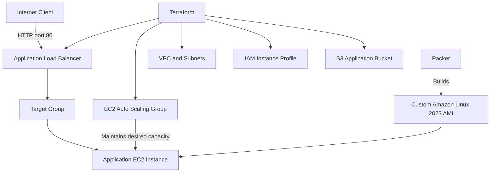

# Infra2Agent Architecture

## Overview

Infra2Agent is an AWS infrastructure portfolio project using Terraform and Packer. It combines network segmentation, an Application Load Balancer (ALB), an EC2 Auto Scaling Group (ASG), and a custom Amazon Linux 2023 AMI.

## Architecture Diagram

## Network Design

- AWS Region: `ap-south-1`
- VPC CIDR: `10.20.0.0/16`
- Public subnets: `10.20.1.0/24` and `10.20.2.0/24`
- Private application subnets: `10.20.11.0/24` and `10.20.12.0/24`
- Private database subnets: `10.20.21.0/24` and `10.20.22.0/24`
- S3 Gateway VPC endpoint configured.

The ALB is internet-facing and uses public subnets. The application ASG uses private application subnets. The current configuration has no NAT route for the private application subnets, so connectivity to external services must be considered separately.

## Application Traffic Flow

1. A client sends an HTTP request to the ALB.
2. The ALB forwards traffic to its target group.
3. The target group routes traffic to a healthy registered EC2 instance.
4. Apache HTTP Server serves the application page.
5. The ASG maintains its configured desired capacity.

The application security group permits inbound HTTP traffic from the ALB security group.

## Compute and Image Management

Packer builds a custom Amazon Linux 2023 x86_64 AMI with Apache installed and enabled.

Terraform configures an EC2 launch template that references this AMI and attaches an IAM instance profile. IMDSv2 is required by the launch template.

The ASG uses the private application subnets and is configured with minimum, desired, and maximum capacity of one instance.

## Identity and Security

- EC2 instance profile attached to the launch template.
- AmazonSSMManagedInstanceCore policy attachment.
- Scoped Secrets Manager read policy for the application secret.
- Application security group restricts inbound HTTP traffic to the ALB security group.
- IMDSv2 required by the launch template.

**Validation note:** SSM connectivity from private application instances must be verified separately because the SSM interface endpoints were deferred in the current configuration.

## State Management

Terraform uses an S3 backend with native lockfile-based state locking. Terraform state, credentials, and sensitive environment variable files must not be committed to Git.

## Design Considerations

- A desired capacity of one is appropriate for this learning exercise but does not provide multi-instance application redundancy.
- The ALB and retained EBS snapshots may incur ongoing charges.
- Successful instance replacement does not guarantee zero downtime for every failure scenario.
- Further production-oriented work could include monitoring, alerting, automated testing, CI/CD, and deployment rollback strategies.